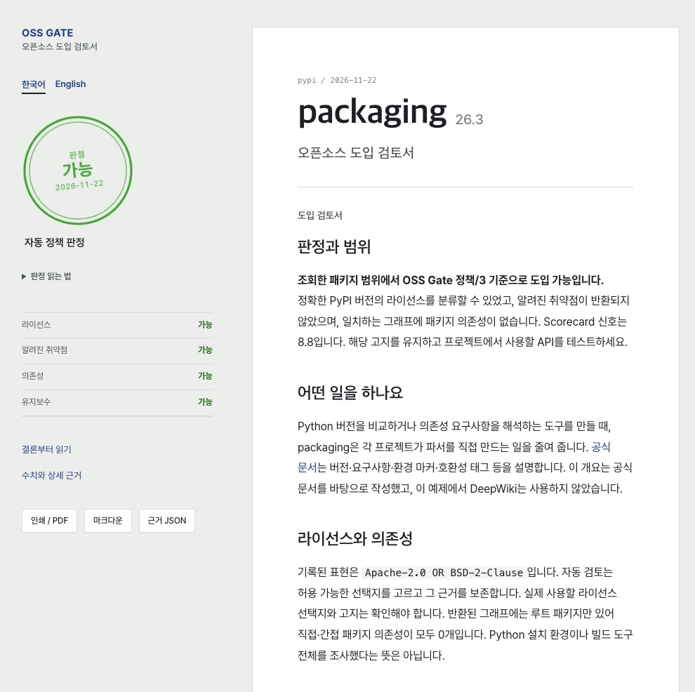

# OSS Gate

**패키지를 이해하기 쉬운 도입 검토서로. 지금 쓰는 에이전트 안에서.**

[English](README.md) · [데모](https://yesolz.github.io/oss-gate/) · [설치 안내](docs/installation.ko.md) · [판정 기준](docs/policy.md)

이 라이브러리는 어떤 일을 하고, 도입 전에 무엇을 확인해야 할까요? OSS Gate는 라이선스·알려진 취약점·의존성 경로·유지보수 신호를 모아 근거와 함께 읽고 공유할 수 있는 검토서를 만듭니다.

[](https://yesolz.github.io/oss-gate/examples/reviews/pypi-packaging-26.3/report.ko.html)

설치한 다음 에이전트에게 요청하세요.

```text
oss-review로 pypi packaging 26.3의 도입을 검토하고 한국어 보고서를 만들어줘.
```

**읽기 쉬운 HTML, 수정 가능한 Markdown, 근거 JSON**을 함께 받습니다. [예제 열기](examples/reviews/pypi-packaging-26.3/report.ko.html) · [Markdown 읽기](examples/reviews/pypi-packaging-26.3/review.ko.md). 화면은 저장된 검토 결과이며 이후 조회에서도 같은 판정이 나온다는 뜻은 아닙니다.

기존 Claude Code·Codex 계정을 사용합니다. OSS Gate용 서버나 별도 모델 API 키는 필요하지 않습니다. 기본 검토에는 정책 설정도 필요 없습니다. 로컬 MCP 어댑터가 포함된 기본 플러그인 또는 MCP 서버를 등록하지 않는 [CLI 전용 플러그인](docs/installation.ko.md)을 선택할 수 있습니다.

## 설치

플러그인과 로컬 MCP를 지원하는 최신 Claude Code 또는 Codex 클라이언트, [uv](https://docs.astral.sh/uv/getting-started/installation/)가 필요합니다. Python 3.10 이상은 uv가 준비할 수 있습니다. 웹 채팅만으로는 번들된 로컬 서버를 실행할 수 없습니다.

Claude Code:

```sh
claude plugin marketplace add yesolz/oss-gate
claude plugin install oss-gate@oss-gate
```

플러그인 CLI를 지원하는 Codex:

```sh
codex plugin marketplace add yesolz/oss-gate
codex plugin add oss-gate@oss-gate
```

설치 후 새 에이전트 세션을 시작합니다. Codex에 `plugin add`가 없으면 로컬 마켓플레이스 설치 화면이나 [MCP·스킬 수동 설정](docs/installation.ko.md)을 사용합니다. 저장소 배포와 공식 공개 플러그인 스토어 등록은 별개입니다.

## 사용

Claude Code:

```text
/oss-gate:oss-review pypi requests 2.25.1 --language ko
/oss-gate:oss-review https://github.com/fastapi/fastapi --language en
/oss-gate:oss-review npm next 15.1.0 --language both
```

Codex에서는 설치된 `oss-review` 스킬을 지정합니다.

```text
oss-review로 pypi requests 2.25.1을 검토하고 한국어로 작성해 줘.
```

**한국어·영어·둘 다**를 선택할 수 있습니다. 지정하지 않으면 요청한 언어를 따릅니다. 두 언어는 하나의 근거 스냅샷과 판정을 공유합니다. 나중에 번역을 요청하면 기존 자료를 사용하고, 갱신을 요청하면 새 스냅샷을 만듭니다.

기본 위치는 `<workspace>/reviews`이며, 에이전트가 절대 경로를 지정하고 실제 저장 위치를 알려줍니다. CLI에서 `--output-root`를 생략하면 실행한 폴더 아래의 `reviews`를 사용합니다.

```text
reviews/<패키지-버전>/<시각-고유값>/
  data.json                 # 정리된 근거와 코드로 계산한 판정
  api-responses.json        # 공개 API의 원본 JSON 응답
  evidence-sha256.json      # 무결성 해시
  deepwiki.overview.json    # 실패도 보존하는 설명 응답
  deepwiki.json             # 주제별 응답 파일 목록
  verification.json         # 에이전트의 근거 점검 결과
  review.ko.md              # 선택한 언어만 생성
  report.ko.html
  review.en.md
  report.en.html
```

HTML은 오프라인에서 열리며, 브라우저에서 PDF로 인쇄할 수 있습니다. 검토 결과를 받는 OSS Gate 백엔드는 없습니다. 기존 결과에는 `oss-viz`, `periodic-report`, `proposal-draft`도 사용할 수 있습니다. [사용 안내](docs/usage.ko.md)

## 무엇이 좋은가

“이 소프트웨어가 무엇을 하는지”, “도입 전에 무엇을 확인해야 하는지”, “그 판단의 근거가 어디에 있는지”를 한 문서에서 읽고 동료와 논의할 수 있습니다. 버전, 한계, 후속 조치와 출처를 함께 남깁니다.

OSV Scanner와 같은 취약점 데이터를 사용해도 검토 흐름은 다를 수 있습니다. 같은 API를 쓴다는 이유만으로 검사 범위가 같다고 할 수는 없습니다. lockfile 파싱, 생태계 지원, 의존성 해석과 분석 기능에 차이가 있습니다. OSS Gate는 에이전트를 이용한 도입 검토 도구이며 전문 스캐너, 법적 판단, 기업 SCA 체계를 대신하지 않습니다. [범위와 정책](docs/policy.md)

패키지·취약점 근거는 deps.dev와 OSV에서, 선택적인 저장소 설명은 DeepWiki에서 가져옵니다. 판정은 코드가 계산하고 설명 문서는 에이전트가 작성합니다. 호출한 외부 서비스에는 조회 식별자가 전달됩니다. [데이터 흐름과 선택 설정](docs/customization.ko.md)에서 확인할 수 있습니다.

## 예제와 데모

[예제](examples/README.md)에는 새로운 가능 판정 예제와 과거 패키지 검토서 네 개, 정기 리포트와 도입 제안서가 **한국어·영어 각각** 있습니다. 각 보고서에 수집일을 표시합니다. 과거 예제는 2026-11-17 자료이고 packaging 예제는 2026-11-22에 수집했습니다. 모두 저장된 결과입니다. 이전 버전의 그래프를 쓴 FastAPI 판정, 수정 버전이 있어도 남는 과거 버전의 취약점, 원본이 없는 Flask의 집계 제외 같은 교정 사항도 표시했습니다.

웹은 **입력을 받지 않는 정적 데모**입니다. 패키지 입력, 계정, API 경로와 모델 호출이 없습니다. `uv run --frozen python scripts/build_site.py`로 생성한 `site/generated`를 정적 호스팅으로 제공하면 됩니다. 공개 데모는 [GitHub Pages](https://yesolz.github.io/oss-gate/index.ko.html)에서 제공하며, 포함된 워크플로로 직접 배포할 수도 있습니다. [배포와 기존 웹 정리](docs/deployment.md)

## 개발과 검증

개발·감사 도구는 Python 3.11 이상, 설치한 플러그인 실행은 Python 3.10 이상을 지원합니다.

```sh
git clone https://github.com/yesolz/oss-gate.git
cd oss-gate
uv sync --frozen
uv run --frozen python -m unittest discover -s tests -v
uv run --frozen python scripts/smoke_mcp.py
uv run --frozen python scripts/smoke_mcp.py --live
uv run --frozen python scripts/build_examples.py
uv run --frozen python scripts/build_site.py
```

첫 MCP 테스트는 로컬 프로토콜만, `--live`는 공개 API 연결까지 확인합니다. 개발자 문서·주석·스킬 지침은 영어, 설치·사용 안내와 예제는 두 언어로 관리합니다.

[기여 안내](CONTRIBUTING.md) · [보안](SECURITY.md) · [변경 기록](CHANGELOG.md) · [MIT 라이선스](LICENSE) · [외부 자료 출처](NOTICE.md)

[릴리즈 검증 기록](docs/release-v0.5.0.md)

[선택적 정책과 CLI](docs/customization.ko.md): 일반 검토에는 별도 설정이 필요하지 않습니다.

MCP 등록 없이 CLI로 실행하려면 [설치 안내](docs/installation.ko.md)에서 선택형 `oss-gate-cli` 패키지를 설치하세요.
