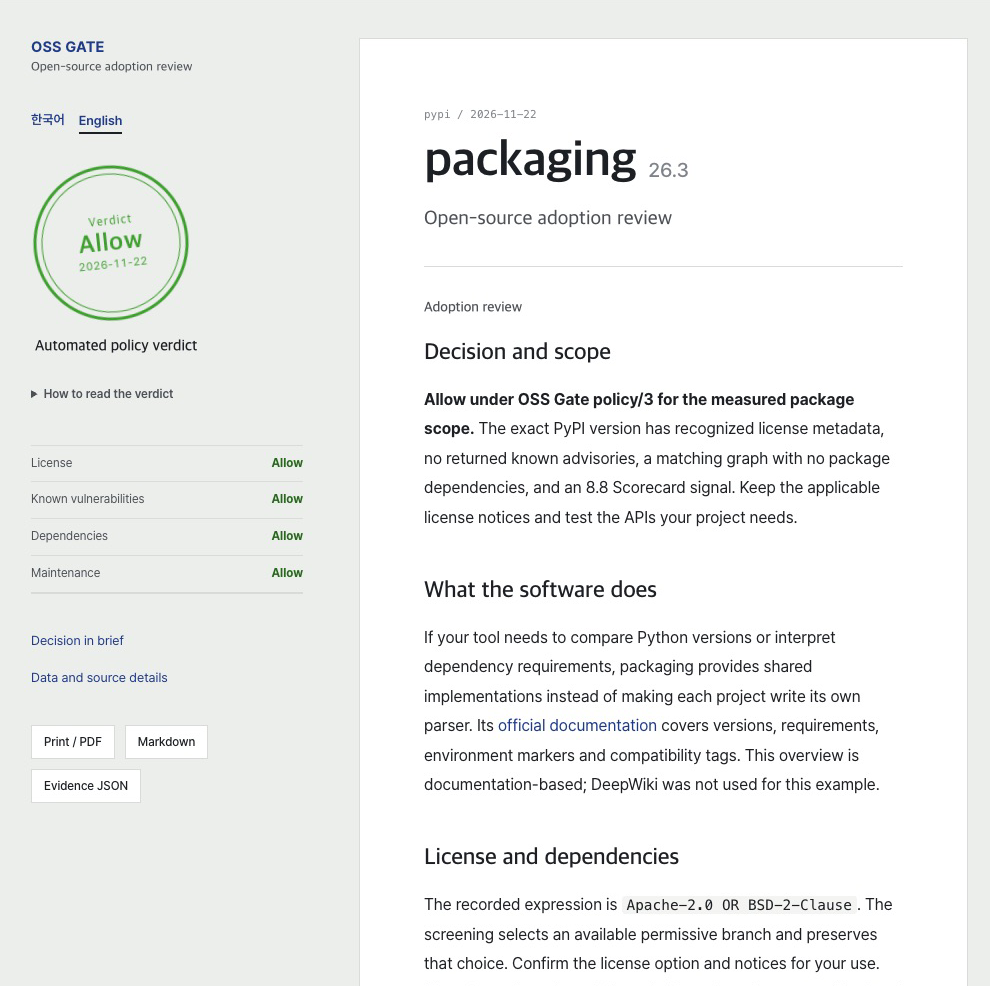

# OSS Gate

**Turn a package into a readable adoption review, inside your own agent.**

[한국어](README.ko.md) · [Live demo](https://yesolz.github.io/oss-gate/) · [Installation](docs/installation.md) · [Decision policy](docs/policy.md)

Understand what a library does, what needs attention, and which evidence supports the result. OSS Gate brings license metadata, known vulnerabilities, dependency paths and maintenance signals into one review you can keep and share.

[](https://yesolz.github.io/oss-gate/examples/reviews/pypi-packaging-26.3/report.en.html)

After installation, ask your agent:

```text
Use oss-review to review pypi packaging 26.3 in English.
```

You get **a readable HTML report, editable Markdown and the underlying evidence JSON**. [Open the example](examples/reviews/pypi-packaging-26.3/report.en.html) or [read its Markdown](examples/reviews/pypi-packaging-26.3/review.en.md). The screenshot is a saved result, not a promise about future scans.

Use your existing Claude Code or Codex account. OSS Gate needs no hosted backend or separate model API key. Ordinary reviews need no policy configuration. Choose the standard plugin with local MCP adapters, or the [CLI-only plugin](docs/installation.md) that registers no MCP servers.

## Install

Use a recent Claude Code or Codex client with plugin and local MCP support, plus [uv](https://docs.astral.sh/uv/getting-started/installation/). Python 3.10+ is required; uv can provision it. Ordinary web-only chat sessions cannot run the bundled local server.

Claude Code:

```sh
claude plugin marketplace add yesolz/oss-gate
claude plugin install oss-gate@oss-gate
```

Codex versions with the plugin CLI:

```sh
codex plugin marketplace add yesolz/oss-gate
codex plugin add oss-gate@oss-gate
```

Restart the agent session after installation. If your Codex version does not have `plugin add`, use its local marketplace installation UI or the [manual MCP and skill setup](docs/installation.md#manual-codex-setup). Distribution through this repository does not imply listing in a public plugin store.

## Use

In Claude Code:

```text
/oss-gate:oss-review pypi requests 2.25.1 --language en
/oss-gate:oss-review https://github.com/fastapi/fastapi --language ko
/oss-gate:oss-review npm next 15.1.0 --language both
```

In Codex, invoke the installed `oss-review` skill, for example:

```text
Use oss-review to review pypi requests 2.25.1 in English.
```

Choose **Korean**, **English**, or **both**. Without a choice, the request language is used. Both languages share one evidence snapshot and verdict. Asking for a translation later reuses the snapshot; asking to refresh creates a new one.

Results normally go to `<workspace>/reviews`; the agent passes an absolute path and reports the returned folder. A direct CLI call without `--output-root` uses `reviews` under its working directory.

A review produces:

```text
reviews/<package-version>/<timestamp-id>/
  data.json                 # normalized evidence and deterministic verdict
  api-responses.json        # original public API JSON
  evidence-sha256.json      # integrity hashes
  deepwiki.overview.json    # exact explanation response, including errors
  deepwiki.json             # index of saved topic responses
  verification.json         # agent evidence check
  review.en.md              # selected language(s) only
  report.en.html
  review.ko.md
  report.ko.html
```

HTML works offline, includes detailed findings and source data, and can be printed to PDF from the browser. No review is sent to an OSS Gate backend. You can also use `oss-viz`, `periodic-report`, and `proposal-draft` for existing results. [Usage guide](docs/usage.md)

Unreleased on this feature branch: [whole-repository reviews](docs/usage.md) for Yarn Berry, Go, Cargo, Java/Kotlin, Swift and imported Trivy/Grype image reports. Each adapter reports its resolution and coverage limits.

## What it adds

OSS Gate helps answer: what does this software do, what needs review before adoption, and which evidence supports that decision? It keeps versions, limitations, suggested actions and source references together in a report you can discuss with a teammate.

OSV Scanner and OSS Gate can use the same vulnerability data while serving different workflows. Sharing OSV data does not establish equivalent scanning coverage: lockfile parsing, supported ecosystems, dependency resolution and analysis capabilities differ. OSS Gate is an agent-assisted review workflow, not a replacement for a dedicated scanner, a legal opinion, or a complete compliance program. [Scope and policy](docs/policy.md)

Package and vulnerability evidence comes from deps.dev and OSV. DeepWiki supplies optional repository context, and your agent writes the explanation. Deterministic code calculates screening results. Invoked services receive the queried identifiers; see [data flow and settings](docs/customization.md).

## Examples and demo

A fresh allow example and four historical package reviews, a periodic report and an adoption proposal are available in **both languages** under [examples](examples/README.md). Each report identifies its collection date. Historical reviews use saved 2026-11-17 data; the packaging example was collected on 2026-11-22. These are saved results. Important corrections are visible: a prior-version graph cannot approve FastAPI's requested version, a fixed release does not clear a vulnerable older release, and a missing Flask snapshot is excluded from portfolio totals.

The web is a **read-only static demo**. It has no package input, account, API route or model call. Build it with `uv run --frozen python scripts/build_site.py`; serve `site/generated` with any static server. The public demo is hosted on [GitHub Pages](https://yesolz.github.io/oss-gate/); the included workflow also supports your own deployment. [Deployment and prototype retirement](docs/deployment.md)

## Develop and verify

Development and audit tools need Python 3.11+; the installed plugin supports Python 3.10+.

```sh
git clone https://github.com/yesolz/oss-gate.git
cd oss-gate
uv sync --frozen
uv run --frozen python -m unittest discover -s tests -v
uv run --frozen python scripts/smoke_mcp.py          # local protocol only
uv run --frozen python scripts/smoke_mcp.py --live   # public API connections
uv run --frozen python scripts/build_examples.py
uv run --frozen python scripts/build_site.py
```

[Contributing](CONTRIBUTING.md) · [Security](SECURITY.md) · [Changelog](CHANGELOG.md) · [MIT license](LICENSE) · [Third-party attribution](NOTICE.md)

[Release validation](docs/release-v0.5.0.md)

[Optional policies and CLI](docs/customization.md): no configuration is needed for ordinary reviews.

Prefer CLI execution without MCP registration? Choose the optional `oss-gate-cli` package in the [installation guide](docs/installation.md).
